# Jenkins CI/CD Pipeline Project

## 1. Project Overview

This project demonstrates the implementation of a Continuous Integration and Continuous Delivery (CI/CD) pipeline using Jenkins, Docker, Git, GitHub, Python, and pytest.

The objective is to automate essential software development tasks, including:

- Retrieving source code from a GitHub repository.
- Creating an isolated Python environment.
- Installing application dependencies.
- Validating Python syntax.
- Running automated unit tests.
- Generating and archiving a ZIP build artifact.
- Triggering Jenkins builds through GitHub webhook integration.

The project uses a simple Python application that adds two numbers to demonstrate how CI/CD automation can improve consistency, repeatability, and early error detection in software development.

## 2. Project Objectives

The main objectives of this project are to:

1. Understand the fundamentals of Continuous Integration and Continuous Delivery.
2. Containerise and run Jenkins using Docker.
3. Manage application source code using Git and GitHub.
4. Define a Jenkins pipeline using a `Jenkinsfile`.
5. Automate dependency installation and application validation.
6. Execute automated tests using pytest.
7. Generate and archive build artifacts.
8. Integrate GitHub webhooks with Jenkins.
9. Document the implementation and provide evidence of successful execution.

## 3. Development Environment

The project was developed using Ubuntu running under Windows Subsystem for Linux 2 (WSL2).

| Tool | Version or configuration |
|---|---|
| Python | 3.12.3 |
| Git | 2.43.0 |
| CI/CD server | Jenkins |
| Container platform | Docker |
| Automated testing framework | pytest |
| Source code repository | GitHub |
| Pipeline definition | Jenkinsfile |

Jenkins was run in a Docker container and accessed through its web interface.

### 3.1 Jenkins Container

Docker was used to run Jenkins in an isolated container environment. The container exposes port `8080` for the Jenkins web interface and port `50000` for inbound agent connections when configured.

The Jenkins dashboard was accessed locally through:

`http://localhost:8080`

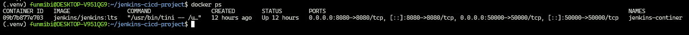

## 4. Project Structure

The project repository is organised as follows:

```text
jenkins-cicd-project/
├── app.py
├── requirements.txt
├── tests/
│   └── test_app.py
├── screenshots/
│   ├── 01-jenkins-container-running.png
│   ├── 02-Jenkins-dashboard.png
│   ├── 03-github-repository.png
│   ├── 04-local-tests-passed.png
│   ├── 05-git-initial-commit.png
│   ├── 06-jenkinsfile.png
│   ├── 07-jenkins-job-configuration.png
│   ├── 08-pipeline-success.png
│   ├── 09-test-results.png
│   ├── 10-build-artifact.png
│   └── 11-github-webhook-trigger.png
├── .gitignore
├── README.md
└── Jenkinsfile
```

## 5. Application Description

The project uses a simple Python application to demonstrate automated validation and packaging.

The application implements an addition function and displays the result of adding two numbers.

Expected application output:

```text
CI/CD demo: 2 + 3 = 5
```

## 6. Python Virtual Environment

Create the virtual environment with:

```bash
python3 -m venv .venv
```

Activate it using:

```bash
source .venv/bin/activate
```
Once activated, the terminal prompt displays `(.venv)`.

Using a virtual environment helps prevent dependency conflicts between different Python projects.

## 7. Dependency Management

The project's Python dependencies are declared in `requirements.txt`.

Install the dependencies locally using:

```bash
python -m pip install -r requirements.txt
```

## 8. Automated Testing

The project uses pytest to execute unit tests against the Python application.

The test suite includes:

- `test_add`: verifies the addition of positive numbers.
- `test_add_negative_numbers`: verifies the addition of negative numbers.

Run the tests locally with:

```bash
python -m pytest -v
```

The Jenkins pipeline also runs the tests and generates a JUnit-compatible XML report.

### 8.1 Test Results

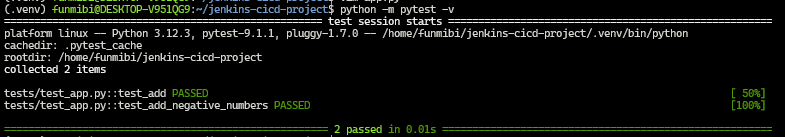

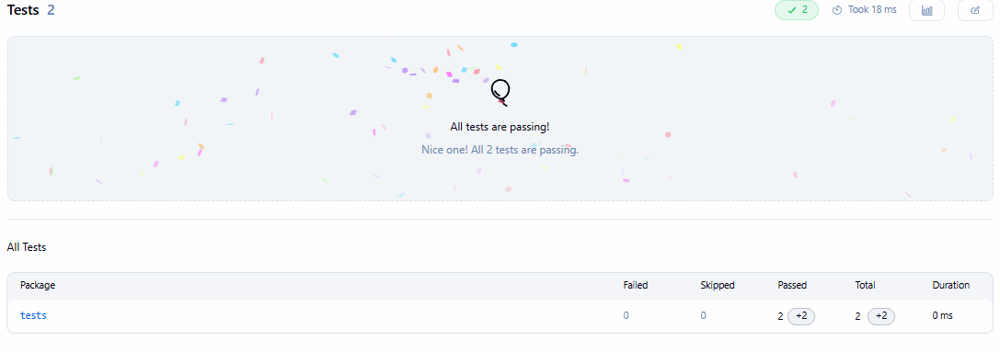


## 9. Application Execution

The application can be executed locally using:

```bash
python app.py
```

Expected output:

```text
CI/CD demo: 2 + 3 = 5
```

This provides a basic check that the application executes and produces the expected result.


## 10. Version Control and GitHub Integration

Git was used to initialise the project repository, track source code changes, and record commits.

**GitHub repository:**  
https://github.com/Funmibi-A/jenkins-cicd

### 10.1 Initial Commit

The initial commit recorded the initial application source code and unit tests.

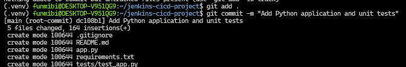

### 10.2 GitHub Repository

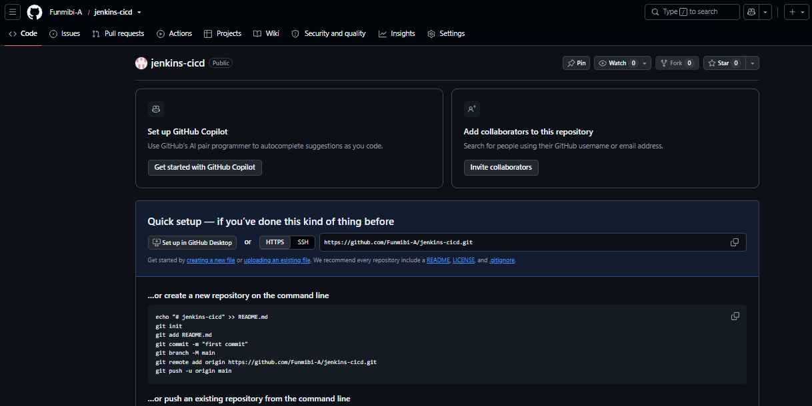

## 11. Jenkins Job Configuration

A Jenkins pipeline job named `jenkins-cicd-pipeline` was configured to retrieve the project from GitHub and execute the pipeline definition stored in the repository.

The job is configured to use the repository's `Jenkinsfile`.

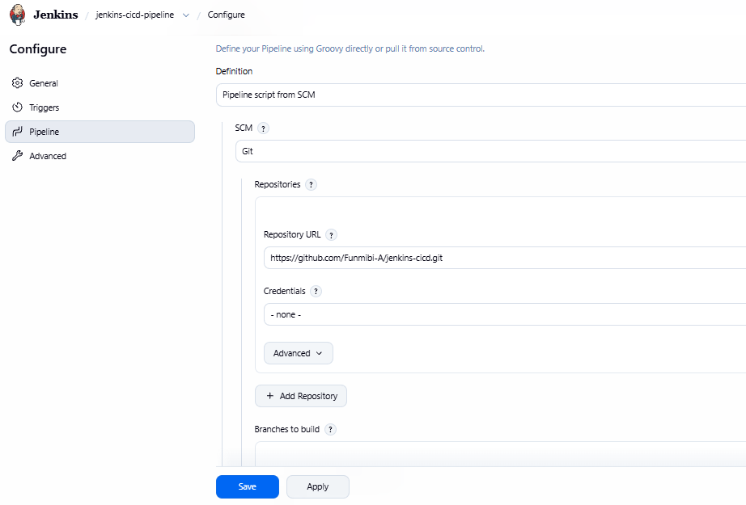

## 12. Jenkins Pipeline as Code

A Declarative Pipeline was defined in a file named `Jenkinsfile` and stored in the root of the GitHub repository.

The pipeline consists of four stages:

1. **Checkout**
2. **Build**
3. **Test**
4. **Package**

Defining the pipeline as code makes the build process version-controlled, reviewable, and repeatable.

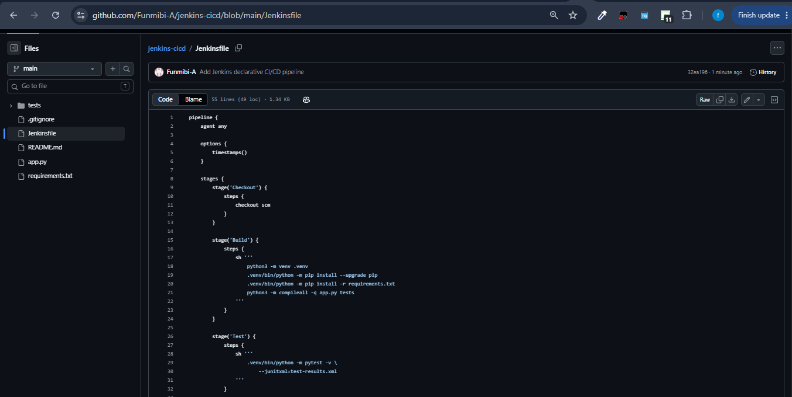

### 12.1 Checkout Stage

The Checkout stage retrieves the project source code from the configured Git repository.

This ensures that Jenkins uses the source code associated with the pipeline's configured revision.

### 12.2 Build Stage

The Build stage performs the following operations:

- Creates a Python virtual environment.
- Upgrades pip.
- Installs dependencies from `requirements.txt`.
- Checks the Python syntax of `app.py` and the `tests` directory.

The syntax check uses:

```bash
python3 -m compileall -q app.py tests
```

If a required command fails, the pipeline stops instead of proceeding as if the build had succeeded.

### 12.3 Test Stage

The Test stage executes pytest:

```bash
.venv/bin/python -m pytest -v --junitxml=test-results.xml
```

The command runs the unit tests and generates `test-results.xml`.

Jenkins processes this file using its JUnit test reporting functionality, making the results available from the build page.

### 12.4 Package Stage

The Package stage creates a ZIP archive containing the application source code, dependency file, and tests.

The archive is named using the Jenkins build number,

```text
dist/jenkins-cicd-1.zip
```

The pipeline removes older matching ZIP files from the workspace before creating the current artifact. Jenkins then archives the generated ZIP and enables fingerprinting.

The artifact can be downloaded from the Jenkins build page.

## 13. Jenkins Build Environment and Troubleshooting

During implementation, the Jenkins container did not initially include all the Python tooling required to execute the pipeline.

The container environment was inspected, and the necessary Python runtime, virtual environment support, pip, and ZIP utilities were installed to support the build and packaging process.

This highlighted an important principle of containerisation: software installed on the host operating system is not automatically available inside a Docker container.

### 13.1 Lessons from Troubleshooting

The following lessons were learned during implementation:

- Container dependencies must be available inside the environment that runs the build.
- A `Jenkinsfile` must contain valid Declarative Pipeline syntax and should not include accidental shell commands intended to create the file itself.
- Pipeline stages should be validated individually when troubleshooting failures.
- Automated tests should execute before an artifact is published.
- Build artifacts should be named consistently and associated with the Jenkins build that produced them.
- Test reports make it easier to identify test failures without relying exclusively on console output.

For a more reproducible production setup, the required build tools could be installed in a custom Jenkins agent image or a dedicated Python build container instead of being installed manually inside the Jenkins controller.

## 14. GitHub Webhook Integration

A GitHub webhook was configured to notify Jenkins when a push event occurs in the repository.

The webhook uses the repository's Jenkins endpoint:

```text
https://striving-shale-frostily.ngrok-free.dev/github-webhook/
```

The public host is provided by the ngrok tunnel, which forwards incoming requests to the local Jenkins service.

The webhook was configured with:

- **Payload content type:** `application/json`
- **Event:** Push events
- **Active:** Enabled

A successful delivery returned HTTP `200`, and Jenkins build output showed a build started by a GitHub push.

The ngrok tunnel must remain active for GitHub to reach a Jenkins instance that is otherwise only accessible locally through the tunnel. The public URL may change when a new tunnel is started.

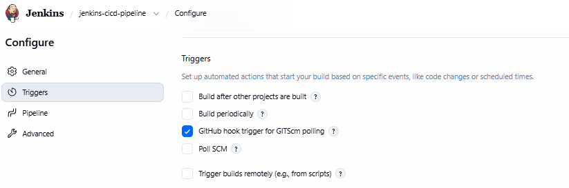

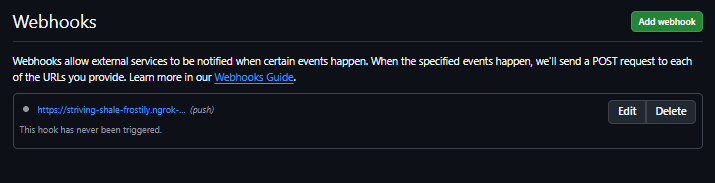

This integration demonstrates how source code changes can initiate an automated build without manually starting the Jenkins job.

## 15. Pipeline Execution Results

The pipeline was successfully executed in Jenkins. The latest successful build observed during implementation was **Build #6**.

The pipeline completed the four configured stages:

| Stage | Purpose | Result |
|---|---|---|
| Checkout | Retrieve source code from GitHub | Successful pipeline stage |
| Build | Prepare Python environment, install dependencies, and check syntax | Successful pipeline stage |
| Test | Execute pytest and publish the test report | Successful pipeline stage |
| Package | Create and archive the ZIP build artifact | Successful pipeline stage |

The Jenkins dashboard showed a successful build, and the test results page showed no failures.


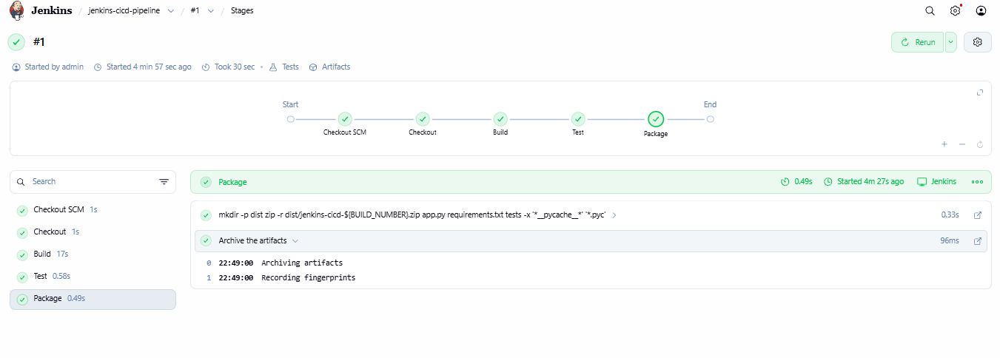

### 15.1 Test Summary

The test suite contains two unit tests. The final reported totals should be taken from the Jenkins Test Result page for the selected successful build.

- Expected tests: 2
- Expected passed: 2
- Expected failures: 0

### 15.2 Build Artifact

The latest successful build observed during implementation archived:

```text
dist/jenkins-cicd-1.zip
```
The artifact is generated during the Package stage and made available through Jenkins.

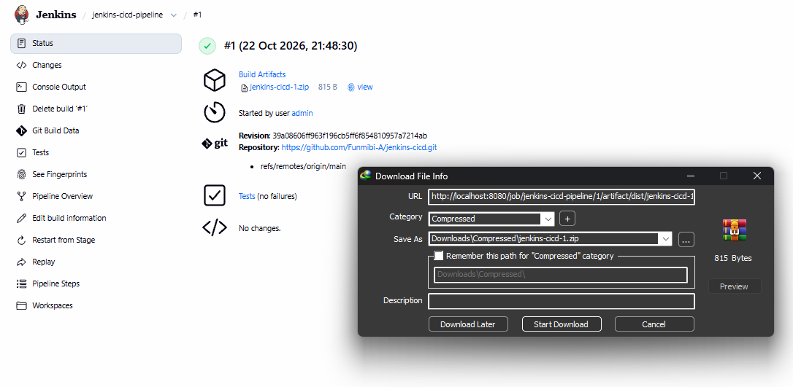

The existence of a ZIP build artifact demonstrates packaging. It does not, by itself, demonstrate deployment to a live application server.

### 16 Container Environments

The project demonstrated that containers have their own software dependencies. Host-level installations do not automatically satisfy dependencies inside Jenkins.

### 16.1 Pipeline Syntax

The Jenkinsfile must follow valid Declarative Pipeline syntax. Incorrect braces, malformed stage definitions, or commands placed outside the appropriate pipeline blocks can prevent Jenkins from loading or executing a pipeline.

### 16.2 Automated Testing

Running unit tests as a dedicated pipeline stage ensures that application changes are validated before the artifact is packaged.

### 16.4 Build Artifacts

Packaging the application into a ZIP file creates a defined output that can be archived and retrieved from Jenkins.

### 16.5 Webhook Integration

GitHub webhooks enable event-driven CI automation. Correct endpoint configuration and network reachability are required for GitHub to notify a locally hosted Jenkins instance.


